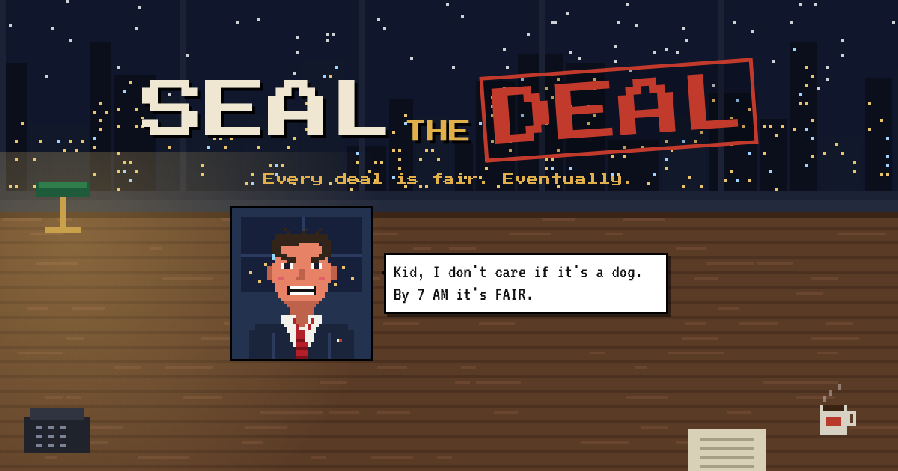

# Seal the Deal

A game about very fair transactions and the people that make them so.

**▶ Play: https://bsovocool16.github.io/seal-the-deal/**



You are an investment banking analyst. Every deal arrives with a terrible price, and you have until the 7:00 AM board call to get the Fairness Committee to agree it is "fair, from a financial point of view." Pull the levers bankers really pull: WACC, terminal growth, stock comp add-backs, the management case, EBITDA add-backs, peer and precedent selection, the equity bridge. Every move costs clock time, and if you push too hard the committee's Smell Test catches you. Run out of time and the MD signs it himself. It is always fair.

Your MD watches the whole night. He gets angrier as you fall behind, and more disheveled as the night goes on. The tie loosens, the jacket comes off, the stubble grows in, and eventually the tie ends up around his head.

## How it plays

- Five made-up deals: three sell-side (push value **down** to justify a lowball offer) and two buy-side (push value **up** to justify overpaying).
- The football field shows DCF, trading comps and precedent ranges against the offer. On medium and hard the offer has to clear a gold **committee line** inside each bar.
- The **Smell Test** falls as your assumptions get harder to defend. Below the bar, the committee kicks it back, and that costs you 30 minutes.
- The approval letter footnotes your choices as assumptions made "at the direction of management."

| | Easy | Medium | Hard |
|---|---|---|---|
| Clock | 9 h | 6 h | 5 h |
| Methods needed | 2 of 3 | 2 of 3 incl. DCF | 3 of 3 |
| Committee line | 10% into bar | 30% | 30% |
| Smell test min | 40 | 55 | 60 |
| Other | every trick allowed | tighter WACC/TGR caps | board case locked, interquartile only, ±1.25% WACC band |

## Run it locally

`index.html` is the whole game in one file. Open it in a browser. No install or server is needed.

## Develop

- `src/engine.js` holds the valuation engine and deal data: DCF, comps, precedents, bridge, plausibility and the committee verdict. It is pure JS and also runs in node.
- `src/game.js`, `src/style.css` and `src/index.html` hold the UI and the canvas pixel art for the desk and the MD.
- `tools/build.js` inlines everything into `index.html` (served by GitHub Pages), `dist/seal-the-deal.html`, and `dist/artifact.html`, which is the same page without the document skeleton.
- `tools/solve.js` is a balance checker. It beam-searches the cheapest path to FAIR for each deal and difficulty.
- `tools/fullrun.js` and `tools/playtest.js` are Playwright smoke tests. A bot plays full runs, and the scripts take screenshots at desktop and phone width.
- `tools/og.js` renders the social preview card, `og.png`.

```
node tools/build.js          # rebuild index.html after editing src/
node tools/solve.js          # check every deal is beatable on every difficulty
node tools/fullrun.js /tmp   # bot plays all three difficulties
```

A work of satire. All companies, deals and people are made up. Nothing here is advice, financial or moral.
